# Automated Production Line & Digital Twin: Master Guide

## 1. Executive Summary
This document outlines the architecture, hardware identification, technical manuals, and deployment plan for setting up the newly acquired physical production line and constructing its corresponding **Digital / Visual Twin Simulation**.

---

## 2. Production Line Workflow & Machine Flow

```mermaid
flowchart LR
    L[1. ZB2535SBJ<br/>Auto Loader] --> P[2. ZB-4535LYS<br/>Solder Printer]
    P --> C1[Conveyor Link]
    C1 --> M[3. WS-8Y<br/>Pick & Place]
    M --> C2[Conveyor Link]
    C2 --> O[4. ZBRF-835<br/>Reflow Oven]
    O --> C3[Conveyor Link]
    C3 --> AOI[5. ZB-800A<br/>2D AOI Inspection]
    AOI --> D[6. Delta SCARA<br/>Dispensing / Screw]
    D --> U[7. ZB2535XBJ<br/>Auto Unloader]
    U -.-> AMR[8. NEXT CMR1000 AMR<br/>+ ABB GoFa Cobot]
    AMR -.-> BOX[9. Box Folding &<br/>Packaging Cell]
```

---

## 3. Communication Architecture
All SMT machines operate on standard **SMEMA interface** handshaking (Board Available / Machine Ready).
For the digital twin and supervisory control:
- **Central Protocol**: OPC UA or Modbus TCP over Industrial Ethernet.
- **AMR Dispatch**: Fleet Management REST API / ROS2 over Wi-Fi.
- **Cobot Control**: ABB OmniCore C30 via RobotWare / PC SDK.

---

## 4. Digital Twin Strategy Without OEM CAD Files

| Component | CAD Sourcing Method | Simulation Role |
| :--- | :--- | :--- |
| **ABB GoFa CRB 15000** | Direct download from **ABB RobotStudio Library** (100% exact OEM model provided by ABB) | Path planning, collision avoidance, payload picking |
| **NEXT CMR1000 AMR** | Parametric extrusion model (Length $\times$ Width $\times$ Height) based on actual chassis tape measurements | SLAM navigation route, docking, and cycle time analysis |
| **Huaqi Zhengbang SMT Machines** | Simplified outer shell / bounding-box models built in Fusion 360 using photos in `assets/` | Physical line spacing, layout footprint, conveyor height alignment |
| **Conveyor Tracks** | Standard modular extrusion models (2020 / 3030 / 4040 aluminum profiles) | Inter-station board transit simulation |
